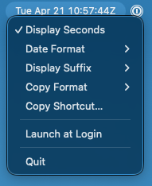

# ZuluBar

Lightweight UTC clock for the macOS menu bar with one-click copy and customizable formats.

## Get ZuluBar

- **[Get the signed build](https://zulubar.app)** — Signed, notarized, with auto-updates ($5)
- **[Build from source (free)](#development)** — Unsigned, no auto-updates
- **[Changelog](CHANGELOG.md)**

## Usage



- **Left-click a clock** → Copy that clock's time to clipboard
- **Right-click any clock** → Settings menu
- **Global copy shortcut** → Always copy UTC

Display options:

- Toggle seconds on/off
- Suffix: `14:23:45Z` or `14:23:45 UTC` or `14:23:45`
- Date prefix: none, `Tue Dec 2 14:23:45 UTC`, or `Tue 2 Dec 14:23:45 UTC`

Copy formats:

- Display: `14:23:45Z`
- Unix Timestamp: `1733150625`
- RFC 3339: `2025-12-02T14:23:45Z`

### Additional time zones

Right-click → **Time Zones…** to search by city, country, IANA identifier, or older zone name. Select a result and click **Add**; use **Remove**, **Move Up**, and **Move Down** to manage the extra clocks. Changes are saved immediately.

UTC always stays first, with its original single-line appearance. Extra clocks show the city above its local weekday/time. The seconds toggle applies to every clock; date-prefix and suffix settings still apply only to UTC. With no extra clocks configured, the display is unchanged.

Clicking a city copies its local time using the selected copy format. Readable copies include the city and numeric UTC offset; RFC 3339 copies include the local offset; Unix timestamps represent the same instant in every zone. The global shortcut always copies UTC. Each clock has its own brief copy confirmation.

macOS supplies daylight-saving and timezone rules. The built-in picker catalog supplies names and aliases, not a second timezone engine. Distinct linked cities such as Montreal and Toronto remain selectable; old spellings such as Calcutta find the preferred Kolkata entry. Extra clocks use menu-bar space, so keep the list short on crowded or notched displays. If the catalog cannot be loaded, existing clocks continue working and remain removable/reorderable, but adding clocks is disabled with an explanation.

## Free vs. Paid

ZuluBar is 100% open source (MIT). You can build it yourself for free with full functionality.

The paid version adds:

- Code-signed and notarized — no Gatekeeper warnings
- Automatic updates
- Supports continued development

## Development

Requires macOS 14.0+ and Xcode 16.0+. Open `ZuluBar.xcodeproj` and run (⌘R).

Architecture: `AppDelegate` owns lifecycle, menus, the shared clock timer, and clipboard routing. It delegates to `Settings` for preferences, `StatusBarRenderer`/`TimeFormatter` for UTC, `ZoneClockFormatter` for local time, `ClockStripController` for clock presentation and feedback, `TimeZonesPanel` for the picker, and `HotKeyManager` for global hotkey registration.

**Run tests:** ⌘U in Xcode or:

```bash
xcodebuild test \
  -project ZuluBar.xcodeproj \
  -scheme ZuluBar \
  -configuration Debug-Free \
  -derivedDataPath ./build/DerivedDataLocal \
  CODE_SIGNING_ALLOWED=NO
```

Build configurations:

- `Debug-Free` / `Release-Free` (unsigned)
- `Debug-Paid` / `Release-Paid` (signed)

Common commands:

```bash
# Free (unsigned)
make run           # build and launch (quickest)
make build-free
make build-free-release
make zip-free

# Paid (signed)
make build-paid
make build-paid-release
make zip
```

### Refreshing picker metadata

The committed `ZuluBar/TimeZoneCatalog.json` is generated from IANA tzdb 2026e's `zone.tab` and `backward` files. Ordinary builds need no download or Python step. To refresh the names/search metadata, download those two files from the same pinned [IANA release](https://data.iana.org/time-zones/tzdb-2026e/) into an ignored directory, then run:

```bash
python3 scripts/generate-timezone-catalog.py \
  --source-dir build/timezone-inputs \
  --version 2026e \
  --output ZuluBar/TimeZoneCatalog.json
PYTHONDONTWRITEBYTECODE=1 python3 -m unittest discover \
  -s scripts -p 'test_generate_timezone_catalog.py'
make test
```

The generator keeps meaningful geographic links, treats renamed/technical names as search aliases, and never infers a linked city's country from its rule target. Review the generated diff when changing releases. Foundation validates availability on the user's OS; the app does not download timezone rules.

Maintainer release notes live in [docs/releasing.md](docs/releasing.md).

## Contributing

Pull requests welcome. See [CONTRIBUTING.md](CONTRIBUTING.md).

## License

MIT - see [LICENSE](LICENSE)
